# Git_HomeWork

## Git Branching Cheat Sheet

Branch ဆိုတာ အလုပ်အသစ်တစ်ခုကို သီးခြားခွဲလုပ်ဖို့
သုံးတာပါ။ ဥပမာ main ကနေ feature branch ခွဲပြီး
Login page ရေးနိုင်တယ်။

### 1. Branch တွေ ကြည့်မယ်

```bash
git branch
```

ဥပမာ အဖြေ—

```text
  feature
* main
```

`*` ပါတဲ့ main က အခု ကိုယ်ရှိနေတဲ့ branch ပါ။

### 2. Branch အသစ်လုပ်မယ်

```bash
git branch feature
```

feature branch အသစ်လုပ်ပေးတယ်။
ဒါပေမယ့် ကိုယ်က main ပေါ်မှာပဲ ရှိနေသေးတယ်။

### 3. ရှိပြီးသား Branch ကို ပြောင်းမယ်

```bash
git switch feature
```

အခု feature branch ကို ရောက်သွားပြီ။
ဒီမှာ commit လုပ်ရင် feature ရဲ့ history ထဲ ဝင်မယ်။

main ကို ပြန်ပြောင်းချင်ရင်—

```bash
git switch main
```

### 4. Branch အသစ်လုပ်ပြီး တစ်ခါတည်း ပြောင်းမယ်

```bash
git switch -c feature
```

ဒီ command က အောက်က command နှစ်ခုနဲ့ တူပါတယ်

```bash
git branch feature
git switch feature
```

### 5. Commit ဥပမာနဲ့ ကြည့်မယ်

main မှာ A နဲ့ B commit ရှိတယ်။
main ပေါ်ကနေ feature ခွဲမယ်။

```bash
git switch -c feature
```

main နဲ့ feature နှစ်ခုလုံး က B ကို ညွှန်းနေတယ်။

| Branch | Commit history |
|---|---|
| main | A → B |
| feature | A → B |

feature မှာ Login form ရေးပြီး commit C လုပ်မယ်။

```bash
git add login.html
git commit -m "Add login form"
```

အခုအခြေအနေ 

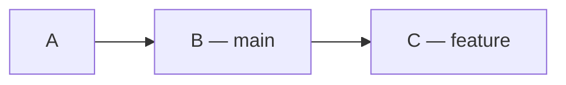

- main က B မှာ ကျန်တယ်။
- feature က C ဆီ ရွှေ့သွားတယ်။
- C ကို main ထဲ ထည့်ချင်ရင် merge လုပ်ရမယ်။

```bash
git switch main
git merge feature
```

### 6. Branch နာမည်ပြောင်း

လက်ရှိ branch က feature ဖြစ်ပြီး login လို့
နာမည်ပြောင်းချင်ရင်—

```bash
git branch -m login
```

### 7. Branch ကို ဖျက်ချင်ရင်

feature ကို main ထဲ merge ပြီးပြီဆိုရင်—

```bash
git switch main
git branch -d feature
```

ဖျက်မယ့် branch ပေါ်မှာ ရှိနေရင် ဖျက်လို့မရဘူး။
main branch ကို အရင်ပြောင်းရတယ်။

`-d` က merge မဖြစ်သေးတဲ့အလုပ်ရှိရင်
ဖျက်တာကို တားပေးနိုင်

Local branch ဖျက်တာနဲ့ GitHub ပေါ်က branch
မပျက်ပါဘူး။

### Command အတိုချုပ်

| လုပ်ချင်တာ | Command |
|---|---|
| Local branch တွေကြည့်မယ် | `git branch` |
| လက်ရှိ branch နဲ့ ဖိုင်အခြေအနေစစ်မယ် | `git status` |
| Branch အသစ်လုပ်မယ် | `git branch feature` |
| ရှိပြီးသား branch ကို ပြောင်းမယ် | `git switch feature` |
| အသစ်လုပ်ပြီး ပြောင်းမယ် | `git switch -c feature` |
| main ကို ပြန်ပြောင်းမယ် | `git switch main` |
| လက်ရှိ branch နာမည်ပြောင်းမယ် | `git branch -m login` |
| အလုပ်ပြီးတဲ့ branch ဖျက်မယ် | `git branch -d feature` |

### Checkout နဲ့ Switch

| Switch command | Checkout command |
|---|---|
| `git switch feature` | `git checkout feature` |
| `git switch -c feature` | `git checkout -b feature` |


# Merge
1. Fast-forward Merge
2. Non-fast-forward Merge
3. Squash Merge


## 1. Fast-forward Merge

main ကနေ feature branch ခွဲပြီးနောက် feature မှာပဲ
commit အသစ်တွေ လုပ်ထားတယ်။ main မှာ commit အသစ် မရှိဘူး။

### ဥပမာ

main မှာ A နဲ့ B commit ရှိတယ်။
B ကနေ feature ခွဲပြီး အလုပ်နှစ်ခု လုပ်ထားတယ်။

- C = Login form ထည့်တယ်။
- D = Login button ထည့်တယ်။

### Merge မလုပ်ခင်

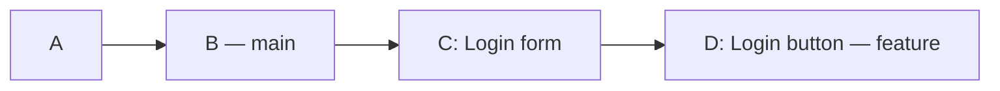
- main ရဲ့ history က A → B ဖြစ်တယ်။
- feature ရဲ့ history က A → B → C → D ဖြစ်တယ်။

### အသုံးပြုရတဲ့ Command

```bash
git switch main
git merge --ff-only feature
```

1. `git switch main` က main branch ကို ပြောင်းတယ်။
2. `git merge --ff-only feature` က main ကို
   feature ရဲ့ နောက်ဆုံး commit D ဆီ ရွှေ့ပေးတယ်။

### Merge လုပ်ပြီး

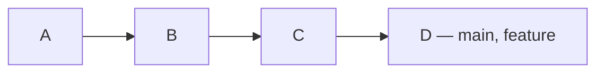

အခုဆိုရင်  main နဲ့ feature နှစ်ခုလုံးက D ကို ညွှန်းနေတယ်။
main ထဲမှာ Login form နဲ့ Login button ရော ပါလာပြီ။

**Commit အသစ် မလုပ်ဘဲ main ကို B ကနေ D ဆီ
ရွှေ့ပေးတာကို Fast-forward merge လို့ ခေါ်တယ်။**

`--ff-only` က fast-forward လုပ်လို့ရမှ ပေါင်းပေးတယ်။
branch နှစ်ခုလုံးမှာ သီးခြား commit အသစ်ရှိနေရင်
merge မလုပ်ဘဲ ရပ်သွားပါမယ် 

## 2. Non-fast-forward Merge

main ကနေ feature ခွဲပြီးနောက် main နဲ့ feature
နှစ်ခုလုံးမှာ သီးခြား commit အသစ်တွေ လုပ်ထားတယ်။

### ဥပမာ

main မှာ A နဲ့ B commit ရှိတယ်။
B ကနေ feature ခွဲထားတယ်။

- feature မှာ C = Login page ထည့်တယ်။
- main မှာ D = Contact page ထည့်တယ်။

### Merge မလုပ်ခင်

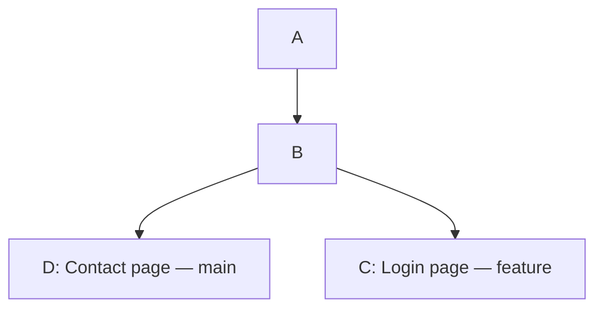

- main ရဲ့ history က A → B → D ဖြစ်တယ်။
- feature ရဲ့ history က A → B → C ဖြစ်တယ်။

နှစ်ဘက်လုံးမှာ အလုပ်အသစ်ရှိလို့ main ကို C ဆီ
ရွှေ့ပေးရုံနဲ့ မရတော့ဘူး။ C နဲ့ D ရဲ့အလုပ်တွေကို
ပေါင်းဖို့ လိုတယ်။

### အသုံးပြုမယ့် Command

```bash
git switch main
git merge feature
```

1. `git switch main` က main branch ကို ပြောင်းတယ်။
2. `git merge feature` က feature ရဲ့ Login အလုပ်နဲ့
   main ရဲ့ Contact အလုပ်ကို ပေါင်းပေးတယ်။

### Merge လုပ်ပြီး

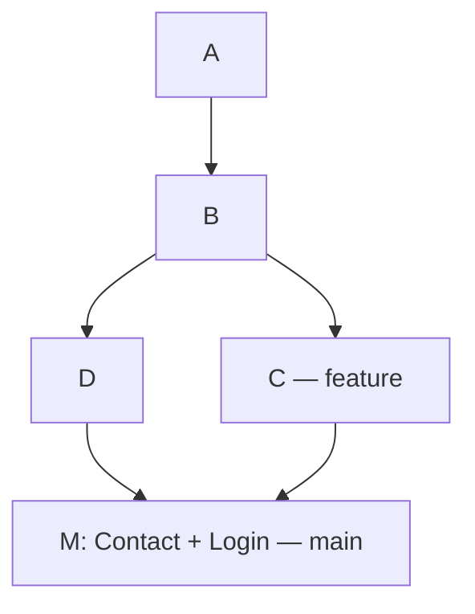

M ဆိုတဲ့ merge commit အသစ် ရလာတယ်။
M က C နဲ့ D ကို ချိတ်ထားပြီး နှစ်ဘက်လုံးရဲ့အလုပ် ပါတယ်။

- main က M ကို ညွှန်းနေပြီ။
- feature က C ကို ညွှန်းနေဆဲ။
- မူရင်း C နဲ့ D commit တွေ ဆက်ရှိတယ်။

**Branch နှစ်ခုရဲ့အလုပ်ကို merge commit အသစ်နဲ့
ပေါင်းချိတ်တာကို Non-fast-forward merge လို့ ခေါ်တယ်။**

### --no-ff ဆိုတာ

Fast-forward လုပ်လို့ရတဲ့အခြေအနေမှာတောင်
merge commit သီးသန့် ထားချင်ရင် `--no-ff` သုံးတယ်။

```bash
git switch main
git merge --no-ff feature
```

## အလွယ်မှတ်ရန်

| အချက် | Fast-forward | Non-fast-forward |
|---|---|---|
| ဒီဥပမာရဲ့အခြေအနေ | feature မှာပဲ အလုပ်အသစ်ရှိတယ် | နှစ်ဘက်လုံးမှာ အလုပ်အသစ်ရှိတယ် |
| main ဘယ်ကိုရောက်လဲ? | feature ရဲ့ နောက်ဆုံး commit ဆီ | merge commit အသစ်ဆီ |
| Merge commit အသစ် | မရှိဘူး | ရှိတယ် |
| Feature branch | ဆက်ရှိတယ် | ဆက်ရှိတယ် |

## Squash Merge

Squash merge ဆိုတာ feature branch က အပြောင်းအလဲတွေကို
main ထဲမှာ commit တစ်ခုတည်းအဖြစ် စုပြီး သိမ်းတာပါ။


### ဥပမာ

main မှာ A နဲ့ B commit ရှိတယ်။
B ကနေ feature branch ခွဲပြီး အောက်ပါအလုပ်တွေ လုပ်ထားတယ်။

| Commit | လုပ်ထားတဲ့အလုပ် |
|---|---|
| C | Login form ရေးတယ် |
| D | Login button ထည့်တယ် |
| E | Login အရောင်ပြင်တယ် |

Merge မလုပ်ခင် history က—

- main: A → B
- feature: A → B → C → D → E

### အသုံးပြုမယ့် Command

```bash
git switch main
git merge --squash feature
git commit -m "Add complete login page"
```

1. `git switch main` က main branch ကို ပြောင်းတယ်။
2. `git merge --squash feature` က feature ရဲ့ အပြောင်းအလဲတွေကို
   main ရဲ့ working files နဲ့ staging area ထဲ ထည့်ပေးတယ်။
   Commit အသစ် မလုပ်ရသေးဘူး။
3. `git commit` က အလုပ်အားလုံးကို S ဆိုတဲ့ commit
   တစ်ခုအဖြစ် သိမ်းတယ်။

### လုပ်ပြီးနောက်

- main: A → B → S
- feature: A → B → C → D → E

S ထဲမှာ Login form၊ Login button နဲ့ အရောင်ပြင်ထားမှု
အားလုံး ပါတယ်။ main history ထဲမှာတော့ C၊ D၊ E
တစ်ခုချင်းမပါဘဲ S တစ်ခုပဲ တိုးလာတယ်။

Feature branch မှာ မူရင်း C၊ D၊ E commit တွေ ဆက်ရှိတယ်။

### အလွယ်မှတ်ရန်

**Squash က အလုပ်တွေကို လျှော့တာမဟုတ်ဘူး။
အလုပ်အဆင့်ဆင့်ကို main ထဲမှာ commit တစ်ခုတည်းနဲ့
စုပြီး မှတ်တမ်းတင်တာပါ။**

## Git Time Traveling Cheat Sheet

Git မှာ commit လုပ်ထားတဲ့ အခြေအနေအဟောင်းတွေကို
ပြန်ကြည့်နိုင်တယ်။ မှားထားတဲ့အလုပ်ကိုလည်း ပြန်ပြင်နိုင်တယ်။

အောက်က ဥပမာတွေကို တစ်ခုချင်း သီးခြားစမ်းရမယ်။
Command အားလုံးကို ဆက်တိုက်လုပ်ဖို့ မဟုတ်ပါဘူး။

### ဥပမာ Commit History

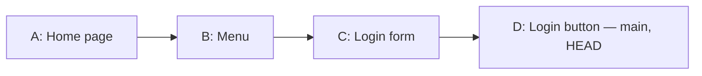

main က D ကို ညွှန်းနေတယ်။
main ပေါ်မှာ ရှိနေလို့ HEAD လည်း D မှာ ရှိတယ်။

- `HEAD` = အခု ကိုယ်ရှိနေတဲ့ commit
- `HEAD~1` = ဒီဥပမာမှာ C
- `HEAD~2` = ဒီဥပမာမှာ B

### 1. Commit History ကြည့်မယ်

```bash
git log --oneline
```

ဥပမာ အဖြေ—

```text
d4e5f6a Add login button
c3d4e5f Add login form
b2c3d4e Add menu
a1b2c3d Add home page
```

အပေါ်ဆုံးက နောက်ဆုံး commit ပါ။
ရှေ့က စာလုံးနဲ့နံပါတ်တွေက commit ID ဖြစ်တယ်။

ဒီ ID တွေက ဥပမာသာဖြစ်လို့ လက်တွေ့သုံးတဲ့အခါ
ကိုယ့် log ထဲက ID ကို အစားထိုးရမယ်။

Commit တစ်ခုမှာ ဘာပြောင်းထားလဲ ကြည့်ချင်ရင်—

```bash
git show c3d4e5f
```

### 2. Commit အဟောင်းကို ပြန်ကြည့်မယ်

C တုန်းက ဖိုင်အခြေအနေကို ကြည့်ချင်ရင်—

```bash
git switch --detach c3d4e5f
```

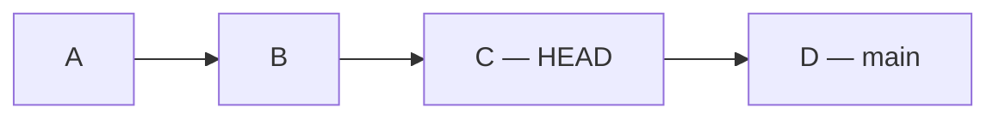

HEAD က C ဆီ ရောက်သွားတယ်။
main ကတော့ D မှာ ရှိနေဆဲ။

Working folder မှာ C တုန်းက ဖိုင်တွေကို မြင်ရမယ်။
ဒီဥပမာမှာ Login form ရှိပြီး Login button မရှိသေးဘူး။

main ကို ပြန်လာချင်ရင်—

```bash
git switch main
```

အခု D ရဲ့ ဖိုင်အခြေအနေကို ပြန်ရောက်ပြီ။

အဟောင်းကနေ အလုပ်အသစ် ဆက်လုပ်ချင်ရင်
branch ခွဲပြီး လုပ်နိုင်တယ်။

```bash
git switch -c experiment
```

### 3. Revert — မှားတဲ့အလုပ်ကို ပြန်ပြောင်းမယ်

D မှာ ထည့်ထားတဲ့ Login button ကို
ပြန်ဖယ်ချင်တယ်လို့ ယူဆပါ။

D ပေါ်မှာ ရှိနေတဲ့အချိန်—

```bash
git revert HEAD
```

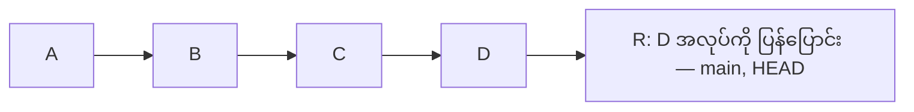

Git က D ကို မဖျက်ဘဲ D ရဲ့အပြောင်းအလဲကို
ပြန်ပြောင်းတဲ့ R commit အသစ် ထည့်ပေးတယ်။

- Login button ထည့်ထားတာ ပြန်ဖယ်သွားမယ်။
- D မှတ်တမ်း ဆက်ရှိတယ်။
- ပြန်ပြင်ထားတဲ့ R မှတ်တမ်းလည်း ရှိတယ်။

GitHub ပေါ်တင်ပြီး အဖွဲ့နဲ့ မျှဝေထားတဲ့ commit ကို
ပြန်ပြင်ဖို့ သင့်တော်တယ်။

### 4. Reset — Branch ကို အဟောင်းဆီ ပြန်ရွှေ့မယ်

မူလ A → B → C → D အခြေအနေကနေ စပါမယ်။

D ပေါ်ကနေ အောက်ပါ reset command တစ်ခုခုသုံးရင်
main ကို C ဆီ ပြန်ရွှေ့ပေးတယ်။

D က main ရဲ့ လက်ရှိ history ထဲ မပါတော့ဘူး။
Commit ကို Git ထဲက ချက်ချင်း အပြီးဖျက်တာ မဟုတ်ဘူး။

#### Soft Reset

```bash
git reset --soft HEAD~1
```

main က C ကို ပြန်ရောက်တယ်။

ဒါပေမယ့် D မှာရေးထားတဲ့ Login button code က
ဖိုင်ထဲမှာလည်း ကျန်တယ်၊ stage ထဲမှာလည်း ကျန်တယ်။

ပြန်သိမ်းချင်ရင် `git commit` လုပ်ရုံပဲ။

#### Mixed Reset

```bash
git reset --mixed HEAD~1
```

main က C ကို ပြန်ရောက်တယ်။

Login button code က ဖိုင်ထဲမှာ ကျန်တယ်။
ဒါပေမယ့် stage ထဲမှာ မရှိတော့ဘူး။

ပြန်သိမ်းချင်ရင်—

```bash
git add login.html
git commit -m "Add login button"
```

#### Hard Reset

```bash
git reset --hard HEAD~1
```

main က C ကို ပြန်ရောက်ပြီး tracked files တွေကိုပါ
C တုန်းကအတိုင်း ပြန်ထားတယ်။

ဒီဥပမာမှာ Login button code ပြန်ပျောက်သွားမယ်။

**Commit မလုပ်ရသေးတဲ့ tracked file အပြောင်းအလဲတွေလည်း
ပျောက်နိုင်လို့ မသုံးခင် သေချာစစ်ရမယ်။**

### Reset သုံးမျိုး နှိုင်းယှဉ်ချက်

| အချက် | Soft | Mixed | Hard |
|---|---|---|---|
| main ကို D ကနေ C ဆီ ရွှေ့လား? | ရွှေ့တယ် | ရွှေ့တယ် | ရွှေ့တယ် |
| D မှာရေးထားတဲ့ code ကျန်လား? | ကျန်တယ် | ကျန်တယ် | ဖိုင်ကို C အတိုင်း ပြန်ထားတယ် |
| D အပြောင်းအလဲ stage ထဲ ကျန်လား? | ကျန်တယ် | မကျန်ဘူး | မကျန်ဘူး |

### 5. Reset မှားသွားရင် Commit ပြန်ရှာမယ်

```bash
git reflog
```

HEAD နဲ့ branch ရွှေ့ခဲ့တဲ့ local မှတ်တမ်းတွေကို
ကြည့်နိုင်တယ်။ ပြန်လိုချင်တဲ့ D ရဲ့ ID ကို ရှာပြီး
branch အသစ်နဲ့ သိမ်းထားနိုင်တယ်။

```bash
git branch recovered d4e5f6a
git switch recovered
```

`reflog` က commit မလုပ်ရသေးတဲ့ code ကို
ပြန်ယူပေးတဲ့ backup မဟုတ်ပါဘူး။

### Command အတိုချုပ်

| လုပ်ချင်တာ | Command |
|---|---|
| Commit history ကြည့်မယ် | `git log --oneline` |
| Commit တစ်ခုရဲ့ အပြောင်းအလဲကြည့်မယ် | `git show <commit-id>` |
| အဟောင်းကို ကြည့်ရုံကြည့်မယ် | `git switch --detach <commit-id>` |
| main ကို ပြန်လာမယ် | `git switch main` |
| နောက်ဆုံး commit ရဲ့အလုပ်ကို ပြန်ပြောင်းမယ် | `git revert HEAD` |
| Commit ဖြုတ်ပြီး code နဲ့ stage ကို ထားမယ် | `git reset --soft HEAD~1` |
| Commit ဖြုတ်ပြီး code ကိုပဲ ထားမယ် | `git reset --mixed HEAD~1` |
| Commit ဖြုတ်ပြီး tracked files ပါ အဟောင်းပြန်ထားမယ် | `git reset --hard HEAD~1` |
| ရွှေ့ခဲ့တဲ့ commit တွေ ပြန်ရှာမယ် | `git reflog` |

`<commit-id>` နေရာမှာ ကိုယ့် commit ID ကို ထည့်ပါ။

### အလွယ်မှတ်ရန်

- အဟောင်းကို ကြည့်ရုံဆို `switch --detach`
- မှတ်တမ်းဟောင်းကို ထားပြီး ပြန်ပြင်ချင်ရင် `revert`
- Branch ကို အဟောင်းဆီ ပြန်ရွှေ့ချင်ရင် `reset`

အဟောင်းကို သွားကြည့်တာ၊ revert သို့မဟုတ် reset
မလုပ်ခင် `git status` နဲ့ လက်ရှိအလုပ်ကို စစ်ပါ။
Push ပြီးသား အဖွဲ့သုံး history ကို ပြန်ပြင်ရာမှာ
reset ထက် revert ကို ဦးစားပေးစဉ်းစားပါ။

## Rebase vs Merge Cheat Sheet

Merge နဲ့ Rebase နှစ်ခုလုံးက branch တွေရဲ့အလုပ်တွေကို
ပေါင်းစပ်ဖို့ သုံးတယ်။ Commit history ထားပုံ ကွာတယ်။

### စတင်အခြေအနေ

A နဲ့ B commit ရှိတဲ့ main ကနေ feature ခွဲထားတယ်။

- feature မှာ C = Login form ရေးတယ်။
- feature မှာ D = Login button ထည့်တယ်။
- main မှာ E = Contact page ထည့်တယ်။

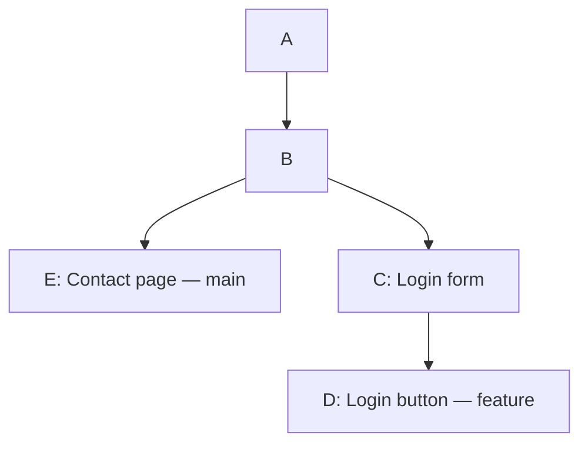

| Branch | Commit history |
|---|---|
| main | A → B → E |
| feature | A → B → C → D |

အောက်က Merge နဲ့ Rebase ဥပမာတွေကို ဒီအခြေအနေကနေ
သီးခြားစတယ်လို့ ယူဆပါ။ ဆက်တိုက်လုပ်ဖို့ မဟုတ်ပါဘူး။

### 1. Merge

Feature ရဲ့ Login အလုပ်တွေကို main ထဲ ပေါင်းမယ်။

```bash
git switch main
git merge feature
```

#### လုပ်ပြီးနောက်

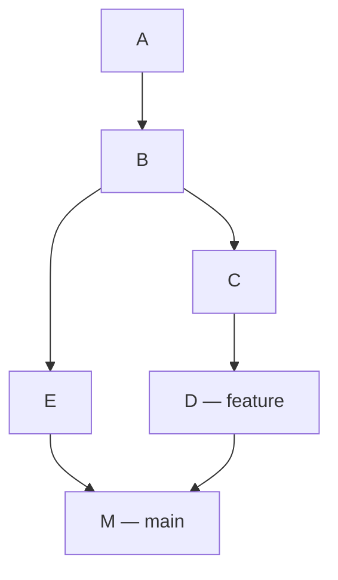

- E နဲ့ D ကို ချိတ်တဲ့ M merge commit အသစ် ရတယ်။
- မူရင်း C၊ D၊ E commit တွေ မပြောင်းဘူး။
- main က M ကို ညွှန်းတယ်။
- feature က D ကို ညွှန်းနေဆဲ။
- main မှာ Contact page နဲ့ Login အလုပ်တွေ ပါလာတယ်။

**Merge က ခွဲလုပ်ထားတဲ့ history နှစ်ခုကို ပေါင်းချိတ်တာပါ။**

### 2. Rebase

ကိုယ့် feature အလုပ်တွေကို main ရဲ့ နောက်ဆုံးအလုပ်
E အပေါ်မှာ ပြန်တင်မယ်။

```bash
git switch feature
git rebase main
```

#### လုပ်ပြီးနောက်

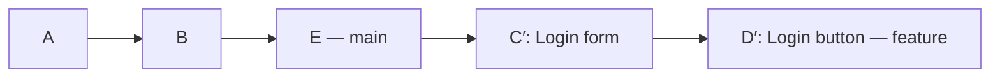

Git က—

1. main ရဲ့ E ကို base အသစ်အဖြစ် ယူတယ်။
2. C ရဲ့ Login form အပြောင်းအလဲကို E အပေါ်
   ပြန်တင်ပြီး C′ commit လုပ်တယ်။
3. D ရဲ့ Login button အပြောင်းအလဲကို C′ အပေါ်
   ပြန်တင်ပြီး D′ commit လုပ်တယ်။

C′ နဲ့ D′ က commit အသစ်တွေဖြစ်လို့
မူရင်း C၊ D နဲ့ commit ID မတူတော့ဘူး။

| Branch | Rebase မလုပ်ခင် | Rebase လုပ်ပြီး |
|---|---|---|
| main | A → B → E | A → B → E |
| feature | A → B → C → D | A → B → E → C′ → D′ |

**Rebase က ကိုယ့် commit တွေကို base အသစ်အပေါ်
ပြန်တင်တာပါ။ ဒီအချိန်မှာ main က E မှာပဲ ရှိသေးတယ်။**

### Rebase ပြီး main ထဲ ထည့်မယ်

main မှာ commit အသစ် ထပ်မလုပ်ထားဘူးဆိုရင်—

```bash
git switch main
git merge --ff-only feature
```

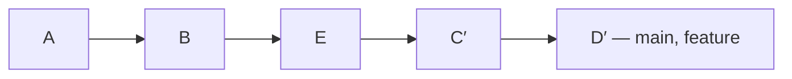

အခု main က D′ ဆီ ရောက်သွားပြီး
Contact page နဲ့ Login အလုပ်တွေ ပါလာပြီ။

### ကွာခြားချက် အတိုချုပ်

| အချက် | Merge | Rebase |
|---|---|---|
| ဘာလုပ်တာလဲ? | History နှစ်ခုကို ပေါင်းချိတ်တယ် | Commit တွေကို base အသစ်အပေါ် ပြန်တင်တယ် |
| မူရင်း commit ID | မပြောင်းဘူး | ပြန်တင်တဲ့ commit ID တွေ ပြောင်းတယ် |
| ဒီဥပမာရဲ့ history | နှစ်လမ်းခွဲပြီး M မှာ ပေါင်းတယ် | တစ်လမ်းတည်း ဖြစ်သွားတယ် |
| ဒီ command တွေက ပြောင်းတဲ့ branch | main | feature |
| ဘယ်အချိန်သုံးလဲ? | အလုပ်ပြီးတဲ့ branch ကို ပေါင်းရာမှာ | ကိုယ့် feature ကို main အသစ်နဲ့ update လုပ်ရာမှာ |

### Conflict ဖြစ်ရင်

ဖိုင်တစ်ခုရဲ့ တူညီတဲ့နေရာကို နှစ်ဘက်က
မတူအောင် ပြင်ထားရင် conflict ဖြစ်နိုင်တယ်။

Conflict ဖြစ်တဲ့ဖိုင်ကို ဖွင့်ပြီး လိုချင်တဲ့စာတွေကို
ထားပါ။ Conflict marker တွေဖယ်ပြီး Save လုပ်ပါ။

Merge ကို ဆက်လုပ်မယ်ဆိုရင်—

```bash
git add <file>
git merge --continue
```

Rebase ကို ဆက်လုပ်မယ်ဆိုရင်—

```bash
git add <file>
git rebase --continue
```

Rebase က commit တစ်ခုချင်း ပြန်တင်တာဖြစ်လို့
conflict ကို တစ်ကြိမ်ထက်ပို ဖြေရှင်းရနိုင်တယ်။

စလုပ်မယ့်အခြေအနေကို ပြန်သွားချင်ရင်—

```bash
git merge --abort
```

သို့မဟုတ် rebase လုပ်နေတယ်ဆိုရင်—

```bash
git rebase --abort
```

`<file>` နေရာမှာ conflict ဖြေရှင်းထားတဲ့
ဖိုင်နာမည်ကို ထည့်ပါ။

### အလွယ်မှတ်ရန်

- Merge = အလုပ်နှစ်ဘက်ကို ပေါင်းချိတ်တယ်။
- Rebase = main အသစ်အပေါ် ကိုယ့်အလုပ်ကို ပြန်တင်တယ်။
- Rebase လုပ်ရုံနဲ့ feature အလုပ်တွေ main ထဲ မဝင်သေးဘူး။
- တခြားသူတွေ ယူသုံးနေတဲ့ branch ကို rebase လုပ်မယ်ဆို
  commit ID ပြောင်းနိုင်လို့ အဖွဲ့နဲ့ အရင်ညှိရမယ်။

