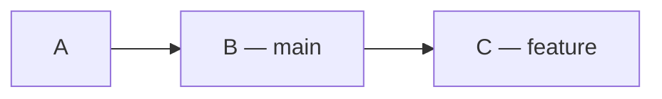
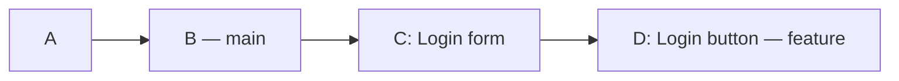
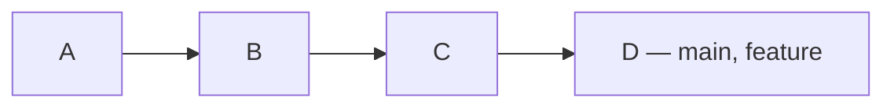
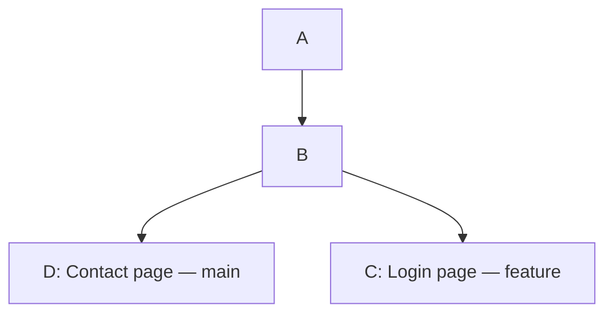
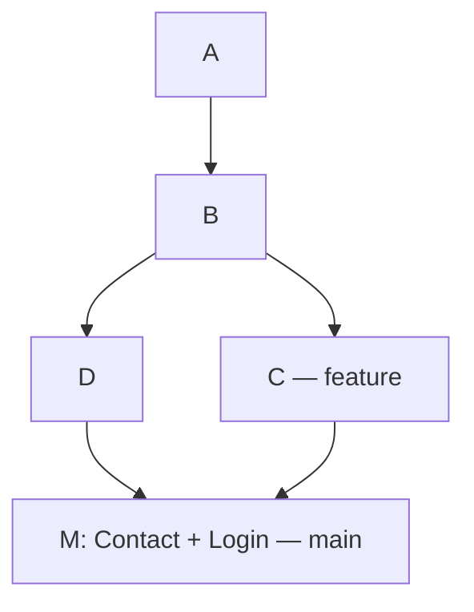

# Git_HomeWork

## Git Branching Cheat Sheet

Branch ဆိုတာ အလုပ်အသစ်တစ်ခုကို သီးခြားခွဲလုပ်ဖို့
သုံးတာပါ။ ဥပမာ main ကနေ feature branch ခွဲပြီး
Login page ရေးနိုင်တယ်။

### 1. Branch တွေ ကြည့်မယ်

```bash
git branch
```

ဥပမာ အဖြေ—

```text
  feature
* main
```

`*` ပါတဲ့ main က အခု ကိုယ်ရှိနေတဲ့ branch ပါ။

### 2. Branch အသစ်လုပ်မယ်

```bash
git branch feature
```

feature branch အသစ်လုပ်ပေးတယ်။
ဒါပေမယ့် ကိုယ်က main ပေါ်မှာပဲ ရှိနေသေးတယ်။

### 3. ရှိပြီးသား Branch ကို ပြောင်းမယ်

```bash
git switch feature
```

အခု feature branch ကို ရောက်သွားပြီ။
ဒီမှာ commit လုပ်ရင် feature ရဲ့ history ထဲ ဝင်မယ်။

main ကို ပြန်ပြောင်းချင်ရင်—

```bash
git switch main
```

### 4. Branch အသစ်လုပ်ပြီး တစ်ခါတည်း ပြောင်းမယ်

```bash
git switch -c feature
```

ဒီ command က အောက်က command နှစ်ခုနဲ့ တူတယ်။

```bash
git branch feature
git switch feature
```

feature ဆိုတဲ့ branch မရှိသေးတဲ့အချိန်မှာ သုံးရတယ်။

### 5. Commit ဥပမာနဲ့ ကြည့်မယ်

main မှာ A နဲ့ B commit ရှိတယ်။
main ပေါ်ကနေ feature ခွဲမယ်။

```bash
git switch -c feature
```

Branch ခွဲရုံနဲ့ commit အသစ် မဖြစ်ဘူး။
main နဲ့ feature နှစ်ခုလုံး B ကို ညွှန်းနေတယ်။

| Branch | Commit history |
|---|---|
| main | A → B |
| feature | A → B |

feature မှာ Login form ရေးပြီး commit C လုပ်မယ်။

```bash
git add login.html
git commit -m "Add login form"
```

အခု အခြေအနေက—



- main က B မှာ ကျန်တယ်။
- feature က C ဆီ ရွှေ့သွားတယ်။
- C ကို main ထဲ ထည့်ချင်ရင် merge လုပ်ရမယ်။

```bash
git switch main
git merge feature
```

### 6. Branch နာမည်ပြောင်းမယ်

လက်ရှိ branch က feature ဖြစ်ပြီး login လို့
နာမည်ပြောင်းချင်ရင်—

```bash
git branch -m login
```

Branch နာမည်ပဲ ပြောင်းတယ်။
Commit နဲ့ ဖိုင်အကြောင်းအရာတွေ မပြောင်းဘူး။

### 7. အလုပ်ပြီးတဲ့ Branch ကို ဖျက်မယ်

feature ကို main ထဲ merge ပြီးပြီဆိုရင်—

```bash
git switch main
git branch -d feature
```

ဖျက်မယ့် branch ပေါ်မှာ ရှိနေရင် ဖျက်လို့မရဘူး။
အရင် main ကို ပြောင်းရတယ်။

`-d` က merge မဖြစ်သေးတဲ့အလုပ်ရှိရင်
ဖျက်တာကို တားပေးနိုင်တယ်။

Local branch ဖျက်တာနဲ့ GitHub ပေါ်က branch
မပျက်ပါဘူး။

### Command အတိုချုပ်

| လုပ်ချင်တာ | Command |
|---|---|
| Local branch တွေကြည့်မယ် | `git branch` |
| လက်ရှိ branch နဲ့ ဖိုင်အခြေအနေစစ်မယ် | `git status` |
| Branch အသစ်လုပ်မယ် | `git branch feature` |
| ရှိပြီးသား branch ကို ပြောင်းမယ် | `git switch feature` |
| အသစ်လုပ်ပြီး ပြောင်းမယ် | `git switch -c feature` |
| main ကို ပြန်ပြောင်းမယ် | `git switch main` |
| လက်ရှိ branch နာမည်ပြောင်းမယ် | `git branch -m login` |
| အလုပ်ပြီးတဲ့ branch ဖျက်မယ် | `git branch -d feature` |

### Checkout နဲ့ Switch

သင်ခန်းစာအဟောင်းတွေမှာ checkout ကို တွေ့နိုင်တယ်။

| Switch command | Checkout command |
|---|---|
| `git switch feature` | `git checkout feature` |
| `git switch -c feature` | `git checkout -b feature` |

ဒီဥပမာတွေမှာ နှစ်မျိုးလုံးက branch ပြောင်းတာ၊
branch အသစ်ခွဲတာကို လုပ်ပေးတယ်။

### မှတ်ထားရန်

Branch မပြောင်းခင် `git status` နဲ့ စစ်ပါ။
မပြီးသေးတဲ့ ဖိုင်အပြောင်းအလဲတွေက တခြား branch ဆီ
ပါသွားနိုင်သလို branch ပြောင်းတာကို Git က
တားနိုင်တာလည်း ရှိတယ်။

အစပိုင်းမှာ အလုပ်ကို commit လုပ်ပြီးမှ
branch ပြောင်းတာ ပိုရှင်းတယ်။

## 1. Fast-forward Merge

main ကနေ feature branch ခွဲပြီးနောက် feature မှာပဲ
commit အသစ်တွေ လုပ်ထားတယ်။ main မှာ commit အသစ် မရှိဘူး။

### ဥပမာ

main မှာ A နဲ့ B commit ရှိတယ်။
B ကနေ feature ခွဲပြီး အလုပ်နှစ်ခု လုပ်ထားတယ်။

- C = Login form ထည့်တယ်။
- D = Login button ထည့်တယ်။

### Merge မလုပ်ခင်


- main ရဲ့ history က A → B ဖြစ်တယ်။
- feature ရဲ့ history က A → B → C → D ဖြစ်တယ်။

### အသုံးပြုမယ့် Command

```bash
git switch main
git merge --ff-only feature
```

1. `git switch main` က main branch ကို ပြောင်းတယ်။
2. `git merge --ff-only feature` က main ကို
   feature ရဲ့ နောက်ဆုံး commit D ဆီ ရွှေ့ပေးတယ်။

### Merge လုပ်ပြီး



အခု main နဲ့ feature နှစ်ခုလုံး D ကို ညွှန်းနေတယ်။
main ထဲမှာ Login form နဲ့ Login button ပါလာပြီ။

**Commit အသစ် မလုပ်ဘဲ main ကို B ကနေ D ဆီ
ရွှေ့ပေးတာကို Fast-forward merge လို့ ခေါ်တယ်။**

`--ff-only` က fast-forward လုပ်လို့ရမှ ပေါင်းပေးတယ်။
branch နှစ်ခုလုံးမှာ သီးခြား commit အသစ်ရှိနေရင်
merge မလုပ်ဘဲ ရပ်သွားမယ်။

## 2. Non-fast-forward Merge

main ကနေ feature ခွဲပြီးနောက် main နဲ့ feature
နှစ်ခုလုံးမှာ သီးခြား commit အသစ်တွေ လုပ်ထားတယ်။

### ဥပမာ

main မှာ A နဲ့ B commit ရှိတယ်။
B ကနေ feature ခွဲထားတယ်။

- feature မှာ C = Login page ထည့်တယ်။
- main မှာ D = Contact page ထည့်တယ်။

### Merge မလုပ်ခင်



- main ရဲ့ history က A → B → D ဖြစ်တယ်။
- feature ရဲ့ history က A → B → C ဖြစ်တယ်။

နှစ်ဘက်လုံးမှာ အလုပ်အသစ်ရှိလို့ main ကို C ဆီ
ရွှေ့ပေးရုံနဲ့ မရတော့ဘူး။ C နဲ့ D ရဲ့အလုပ်တွေကို
ပေါင်းဖို့ လိုတယ်။

### အသုံးပြုမယ့် Command

```bash
git switch main
git merge feature
```

1. `git switch main` က main branch ကို ပြောင်းတယ်။
2. `git merge feature` က feature ရဲ့ Login အလုပ်နဲ့
   main ရဲ့ Contact အလုပ်ကို ပေါင်းပေးတယ်။

### Merge လုပ်ပြီး



M ဆိုတဲ့ merge commit အသစ် ရလာတယ်။
M က C နဲ့ D ကို ချိတ်ထားပြီး နှစ်ဘက်လုံးရဲ့အလုပ် ပါတယ်။

- main က M ကို ညွှန်းနေပြီ။
- feature က C ကို ညွှန်းနေဆဲ။
- မူရင်း C နဲ့ D commit တွေ ဆက်ရှိတယ်။

**Branch နှစ်ခုရဲ့အလုပ်ကို merge commit အသစ်နဲ့
ပေါင်းချိတ်တာကို Non-fast-forward merge လို့ ခေါ်တယ်။**

### --no-ff ဆိုတာ

Fast-forward လုပ်လို့ရတဲ့အခြေအနေမှာတောင်
merge commit သီးသန့် ထားချင်ရင် `--no-ff` သုံးတယ်။

```bash
git switch main
git merge --no-ff feature
```

## အလွယ်မှတ်ရန်

| အချက် | Fast-forward | Non-fast-forward |
|---|---|---|
| ဒီဥပမာရဲ့အခြေအနေ | feature မှာပဲ အလုပ်အသစ်ရှိတယ် | နှစ်ဘက်လုံးမှာ အလုပ်အသစ်ရှိတယ် |
| main ဘယ်ကိုရောက်လဲ? | feature ရဲ့ နောက်ဆုံး commit ဆီ | merge commit အသစ်ဆီ |
| Merge commit အသစ် | မရှိဘူး | ရှိတယ် |
| Feature branch | ဆက်ရှိတယ် | ဆက်ရှိတယ် |

## Squash Merge

Squash merge ဆိုတာ feature branch က အပြောင်းအလဲတွေကို
main ထဲမှာ commit တစ်ခုတည်းအဖြစ် စုပြီး သိမ်းတာပါ။


### ဥပမာ

main မှာ A နဲ့ B commit ရှိတယ်။
B ကနေ feature branch ခွဲပြီး အောက်ပါအလုပ်တွေ လုပ်ထားတယ်။

| Commit | လုပ်ထားတဲ့အလုပ် |
|---|---|
| C | Login form ရေးတယ် |
| D | Login button ထည့်တယ် |
| E | Login အရောင်ပြင်တယ် |

Merge မလုပ်ခင် history က—

- main: A → B
- feature: A → B → C → D → E

### အသုံးပြုမယ့် Command

```bash
git switch main
git merge --squash feature
git commit -m "Add complete login page"
```

1. `git switch main` က main branch ကို ပြောင်းတယ်။
2. `git merge --squash feature` က feature ရဲ့ အပြောင်းအလဲတွေကို
   main ရဲ့ working files နဲ့ staging area ထဲ ထည့်ပေးတယ်။
   Commit အသစ် မလုပ်ရသေးဘူး။
3. `git commit` က အလုပ်အားလုံးကို S ဆိုတဲ့ commit
   တစ်ခုအဖြစ် သိမ်းတယ်။

### လုပ်ပြီးနောက်

- main: A → B → S
- feature: A → B → C → D → E

S ထဲမှာ Login form၊ Login button နဲ့ အရောင်ပြင်ထားမှု
အားလုံး ပါတယ်။ main history ထဲမှာတော့ C၊ D၊ E
တစ်ခုချင်းမပါဘဲ S တစ်ခုပဲ တိုးလာတယ်။

Feature branch မှာ မူရင်း C၊ D၊ E commit တွေ ဆက်ရှိတယ်။

### အလွယ်မှတ်ရန်

**Squash က အလုပ်တွေကို လျှော့တာမဟုတ်ဘူး။
အလုပ်အဆင့်ဆင့်ကို main ထဲမှာ commit တစ်ခုတည်းနဲ့
စုပြီး မှတ်တမ်းတင်တာပါ။**
